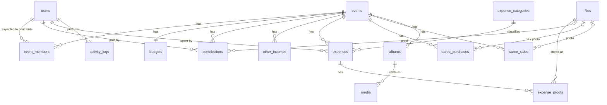

# Durgamatha Event Platform: Architecture

This document answers items A to K of the brief before any application code is written.
It is the reference the team should keep up to date as the system evolves.

---

## A. System architecture

```
                         ┌──────────────────────────────────────────────┐
  Phone / laptop  ──────▶│  React SPA (Vite, TS, Tailwind, Recharts)    │
  (public, team, admin)  │  • Public site  /  /gallery  /finance ...    │
                         │  • Team app     /app/...                     │
                         │  TanStack Query cache + EventSource (SSE)    │
                         └───────────────┬──────────────────────────────┘
                                         │ HTTPS  /api/*  (JSON, multipart)
                                         │ httpOnly session cookie (JWT)
                         ┌───────────────▼──────────────────────────────┐
                         │  Express API (Node 20+, TypeScript)          │
                         │  helmet · CORS · rate limit · zod validation │
                         │  auth middleware → role guard → handler      │
                         │  services: finance, audit, storage, realtime │
                         └──────┬──────────────────────┬────────────────┘
                                │ pg (parameterized)   │ S3 API / local disk
                         ┌──────▼────────┐     ┌───────▼──────────────────┐
                         │ PostgreSQL 16 │     │ Object storage (private) │
                         │ source of     │     │ photos, videos, proofs,  │
                         │ truth         │     │ bills, thumbnails        │
                         └───────────────┘     └──────────────────────────┘
```

Design choices, and why:

| Decision | Choice | Reason |
|---|---|---|
| Shape | One Express API + one React SPA, in a single repo with npm workspaces | Easy for a student team to run, deploy and reason about. No microservices. |
| DB access | `pg` with hand-written parameterized SQL and numbered `.sql` migrations | Transparent, no ORM magic or binary engines, the SQL *is* the documentation. Every query uses `$1` placeholders, so no SQL injection. |
| Validation | `zod` schemas on every request body and query | One place defines shape, limits and error messages. |
| Auth | JWT in an `httpOnly`, `SameSite=Lax` cookie; bcrypt password hashes | No token in `localStorage` (XSS-safe), no extra session table. The user row is re-read on every request, so a deactivated user or a role change takes effect immediately. |
| Realtime | Server-Sent Events (SSE) + TanStack Query refetch | Dashboards only need "something changed, refetch". SSE is plain HTTP, no extra library, works through proxies. Mutations also invalidate queries locally, so the actor sees changes even without SSE. |
| Money | `NUMERIC(12,2)` columns, all totals computed in SQL | No floating point drift, no stored balances. |

---

## B. Database schema (ER diagram)



### Tables

| Table | Key columns | Notes |
|---|---|---|
| `users` | id, name, email (unique, case-insensitive), phone, password_hash, role (`admin`\|`member`), is_active, email_public, phone_public, show_on_public_site, deleted_at | Team members and admins. Public users have no row. Soft delete only (financial records reference users). |
| `events` | id, year (unique), title, description, location, start_date, end_date, default_expected_contribution, is_published, public_finance, public_contributor_names, public_expense_list, deleted_at | One row per year. The three `public_*` flags are the admin's per-year transparency switches. |
| `event_members` | (event_id, user_id) PK, expected_amount | Roster for a year and how much each member is expected to give. Status is **computed**, not stored. |
| `budgets` | event_id PK, planned_amount, notes, updated_by | The plan. Actual balance is always computed from transactions. |
| `contributions` | id, event_id, user_id, amount > 0, paid_on, method, reference, notes, proof_file_id, created_by, deleted_at | Every payment is its own row (partial payments are several rows). |
| `other_incomes` | id, event_id, amount > 0, source, received_on, notes, created_by, deleted_at | Sponsors, donations from outside the team. |
| `expense_categories` | id, name (unique), is_active, sort_order | Seeded with Decoration, Food, Flowers, Sarees, Transportation, Sound, Lighting, Pooja materials, Printing, Other. Admin-managed. |
| `expenses` | id, event_id, amount > 0, spent_on, category_id, description, paid_by, vendor, created_by, updated_by, deleted_at | The core ledger of outgoing money. |
| `files` | id, storage_key (unique), original_name, mime_type, size_bytes, purpose, uploaded_by | Private documents (payment screenshots, bills, saree photos). Never served publicly. |
| `expense_proofs` | id, expense_id, file_id, kind (`payment`\|`bill`) | Several proofs per expense. |
| `saree_purchases` | id, event_id, purchased_on, vendor, quantity > 0, unit_price ≥ 0, total_amount (generated = qty × price), purchased_by, proof_file_id, photo_file_id, notes, deleted_at | Purchase cost counts as an expense in the "Sarees" category. |
| `saree_sales` | id, event_id, sold_on, customer_name, quantity > 0, unit_price ≥ 0, total_amount (generated), recorded_by, photo_file_id, notes, deleted_at | Sale revenue counts as income. Cannot sell more than remaining stock. |
| `albums` | id, event_id, name (unique per event), description, is_public, cover_media_id, sort_order, created_by, deleted_at | Year → Album → media. |
| `media` | id, event_id, album_id, type (`photo`\|`video`), storage_key, thumb_key, original_name, mime_type, size_bytes, width, height, description, is_public, allow_download, is_featured, uploaded_by, deleted_at | Metadata only. Binaries live in object storage. |
| `activity_logs` | id, user_id, action, entity_type, entity_id, event_id, summary, details (jsonb: before/after), ip, created_at | Append-only. A database trigger rejects UPDATE and DELETE. |
| `settings` | key PK, value jsonb | Site-wide: organisation name, about text, contact, auto-publish member uploads. |
| `schema_migrations` | version PK, applied_at | Migration bookkeeping. |

---

## C. Relationships and integrity rules

* Every financial and media row has `event_id NOT NULL REFERENCES events(id)`, so years can never mix. Every list query filters by `event_id`.
* `contributions.user_id`, `expenses.paid_by`, `saree_purchases.purchased_by` reference `users(id)` with `ON DELETE RESTRICT`: a member with money history can be deactivated, never hard-deleted.
* `media.album_id` must belong to the same event as the media row (checked in the service inside the transaction).
* `CHECK` constraints: amounts > 0, quantities > 0, role in the allowed set, media type in the allowed set, year between 2000 and 2100.
* Generated columns for `total_amount = quantity * unit_price` on saree rows, so totals can never disagree with inputs.
* Saree sales lock the event row (`SELECT ... FOR UPDATE`) and check remaining stock in the same transaction, so two phones selling the last saree at once cannot oversell.
* Soft delete (`deleted_at`) on every financial, saree and media row. All aggregates use `WHERE deleted_at IS NULL`. Nothing is silently overwritten: each update writes the before/after values to `activity_logs`.
* Indexes on `(event_id, deleted_at)` for every per-year table, plus `(event_id, spent_on)`, `(event_id, category_id)`, `(event_id, user_id)` for filters, and `(created_at DESC)` / `(event_id, created_at DESC)` on the activity log.

### Calculated, never stored

| Figure | Formula |
|---|---|
| Member paid | `SUM(contributions.amount)` for that member and year |
| Member pending | `GREATEST(expected − paid, 0)` |
| Member status | `paid ≥ expected` → Paid, `paid > 0` → Partial, else Pending |
| Total income | contributions + other income + saree sales |
| Total expenses | expenses + saree purchase cost |
| Current balance | total income − total expenses |
| Saree remaining | purchased qty − sold qty |
| Budget used | total expenses ÷ planned budget |

All of these live in one backend module (`server/src/modules/finance/finance.service.ts`). The frontend only displays them.

---

## D. Folder structure

```
durgamatha/
├── package.json              npm workspaces + root scripts (dev, build, test)
├── .env.example
├── README.md
├── docs/
│   ├── ARCHITECTURE.md       this file
│   └── PHASES.md             what each build phase delivered and how it was tested
├── server/
│   ├── package.json
│   ├── tsconfig.json
│   ├── src/
│   │   ├── index.ts           starts HTTP server
│   │   ├── app.ts             express app: middleware + routers
│   │   ├── config.ts          reads and validates env vars
│   │   ├── db/
│   │   │   ├── pool.ts        pg pool + tx() helper
│   │   │   ├── migrate.ts     runs migrations/*.sql in order
│   │   │   ├── seed.ts        fake development data
│   │   │   └── migrations/    001_init.sql, 002_...
│   │   ├── middleware/        auth, requireRole, validate, upload, errors, rateLimit
│   │   ├── services/          audit.ts, storage/ (local + s3), realtime.ts, images.ts
│   │   ├── modules/           one folder per domain: routes + service
│   │   │   ├── auth/  members/  events/  contributions/  expenses/
│   │   │   ├── finance/  sarees/  albums/  media/  files/
│   │   │   ├── activity/  settings/  public/
│   │   └── utils/
│   └── test/                  vitest + supertest API tests (real Postgres)
└── client/
    ├── package.json
    ├── vite.config.ts
    ├── index.html
    └── src/
        ├── main.tsx, App.tsx (routes)
        ├── lib/               api.ts (axios), format.ts, realtime.ts, queryKeys.ts
        ├── context/           AuthContext, YearContext
        ├── components/        ui/ (Button, Card, Modal, Badge, Table...), charts/, upload/
        ├── layouts/           PublicLayout, AppLayout (sidebar)
        └── pages/
            ├── public/        Home, Events, EventYear, Gallery, Album, Videos, Finance, Sarees, About
            └── app/           Dashboard, Members, Contributions, Expenses, Budget, Sarees,
                               Photos, Videos, Events, Activity, Settings, Profile, Login
```

---

## E. Pages and screens

**Public site** (no login; top navigation: Home, Events, Gallery, Videos, Finance, Saree History, About; year selector where relevant)

| Route | Content |
|---|---|
| `/` | Introduction, current year card, featured photos, featured videos, finance summary, year history strip |
| `/events`, `/events/:year` | Year list; one year's details, albums, videos, finance, sarees, contribution summary |
| `/gallery?year=` , `/gallery/album/:id` | Albums for a year; responsive lazy-loaded photo grid with lightbox and download |
| `/videos?year=` | Public videos with player and download (if allowed) |
| `/finance?year=` | Income, expenses, balance, category breakdown chart, contributor count, optional named contributor sheet, yearly trend |
| `/sarees?year=` | Purchased, sold, remaining; yearly history; sales list if the year allows it |
| `/about` | About text from settings |

**Team / admin app** (`/login`, then `/app/...`, left sidebar on desktop, bottom bar + "+" quick action on mobile, year selector in the header)

| Route | Who | Content |
|---|---|---|
| `/app` | both | Admin: full dashboard (cards, 4 charts, recent tables). Member: my contribution, team status, budget, balance, breakdown, sarees, recent media, quick actions |
| `/app/members` | admin manage, member view | Member list, create/edit/deactivate (admin), public visibility flags |
| `/app/contributions` | both | Status table (expected/paid/pending/status), payments list, add payment with proof |
| `/app/expenses` | both | Live table with search, category/member/date filters, sort, pagination; detail drawer with proofs; add/edit |
| `/app/budget` | admin edit, member view | Planned budget, other income entries, budget vs actual |
| `/app/sarees` | both | Summary, purchases, sales, add forms, inventory |
| `/app/photos`, `/app/videos` | both | Albums, multi-file upload (camera / drag-drop), approve/publish (admin) |
| `/app/events` | admin | Create/edit years, roster and expected amounts, transparency switches |
| `/app/activity` | admin | Full audit log with filters |
| `/app/settings` | admin | Site settings, expense categories |
| `/app/profile` | both | Own profile, change password |

---

## F. API structure

All under `/api`. JSON in and out; uploads are `multipart/form-data`. Errors: `{ "error": { "code", "message", "details?" } }`.
Roles: **A** admin, **M** team member, **P** public (no auth).

| Method & path | Roles | Purpose |
|---|---|---|
| `POST /auth/login` · `POST /auth/logout` · `GET /auth/me` · `PUT /auth/password` | P / A M | Session |
| `GET /members` · `GET /members/:id` | A M | List / view (members see no password or admin-only fields) |
| `POST /members` · `PUT /members/:id` · `DELETE /members/:id` | A | Create, edit (incl. role), deactivate |
| `PUT /members/me` | A M | Edit own profile (name, phone, visibility). Role field is not accepted |
| `GET /events` · `GET /events/:year` | A M | Years |
| `POST /events` · `PUT /events/:year` · `DELETE /events/:year` | A | Manage years (delete = soft) |
| `GET /events/:year/roster` · `PUT /events/:year/roster` | A M / A | Who is expected to pay how much |
| `GET /events/:year/budget` · `PUT /events/:year/budget` | A M / A | Planned budget |
| `GET/POST /events/:year/other-income` · `PUT/DELETE /other-income/:id` | A M / A | Other income |
| `GET /events/:year/contributions` | A M | Status table + payment list |
| `POST /events/:year/contributions` | A M | Add payment (member: only for self) |
| `PUT /contributions/:id` · `DELETE /contributions/:id` | A, M own / A | Edit / soft delete |
| `GET /events/:year/expenses` | A M | Filters: `q, category, paidBy, from, to, sort, page, pageSize` |
| `POST /events/:year/expenses` | A M | Create with `payment` and `bill` files |
| `GET /expenses/:id` · `PUT /expenses/:id` · `DELETE /expenses/:id` | A M / A, M own / A | Detail, edit, soft delete |
| `POST /expenses/:id/proofs` · `DELETE /expense-proofs/:id` | A, M own | Add / remove proofs |
| `GET /expense-categories` · `POST` · `PUT /:id` | A M / A | Categories |
| `GET /events/:year/sarees` | A M | Summary + purchases + sales |
| `POST /events/:year/sarees/purchases` · `POST .../sales` | A M | Record |
| `PUT/DELETE /saree-purchases/:id`, `/saree-sales/:id` | A, M own / A | Edit / soft delete |
| `GET /events/:year/dashboard` | A M | Everything the dashboard needs (section J) |
| `GET /events/trend` | A M | Income/expense per year |
| `GET /events/:year/albums` · `POST` | A M | Albums |
| `PUT /albums/:id` · `DELETE /albums/:id` | A, M own | Edit / soft delete |
| `GET /albums/:id/media` · `POST /albums/:id/media` | A M | List / upload (many files) |
| `PUT /media/:id` · `DELETE /media/:id` | A (publish), M own | Edit, publish, feature, delete |
| `GET /files/:id` | A M | Stream/redirect a private proof |
| `GET /media/:id/file`, `/media/:id/thumb` | A M, P if public | Serve media (checks visibility every time) |
| `GET /activity` | A (full), M (limited feed) | Audit log |
| `GET /settings` · `PUT /settings` | A | Settings |
| `GET /stream` | A M | SSE: `finance`, `media`, `activity` change notices |
| `GET /public/site` · `/public/events` · `/public/events/:year` | P | Site info, years |
| `GET /public/events/:year/finance` · `/sarees` · `/gallery` · `/videos` · `/public/albums/:id` | P | Public data, filtered by published flags |
| `GET /public/stream` | P | SSE for public finance changes |

The URL uses the **year** (`/events/2026/...`) instead of an internal id because it is what people think in, and it is unique.

---

## G. Authentication architecture

1. `POST /api/auth/login` with email + password (rate-limited to 10 attempts / 15 min per IP).
2. Server looks up the active user, compares with `bcrypt` (cost 12). Same error message for "no such user" and "wrong password".
3. On success it signs a JWT `{ sub: userId }` with `JWT_SECRET` (HS256, 7 days) and sets it as cookie `dm_session` (`httpOnly`, `SameSite=Lax`, `Secure` in production).
4. `authenticate` middleware on every private route verifies the JWT, then **loads the user from the database** and rejects inactive/deleted users. The role used for authorization always comes from the database, never from the token or the request body.
5. `requireRole('admin')` guards admin routes. Ownership checks (e.g. "member can edit only their own expense") live in the service layer.
6. State-changing requests require `Content-Type: application/json` or multipart and a same-origin `Origin` header (CSRF defence together with `SameSite`).
7. Admin creates accounts with an initial password; members change it from their profile. The first admin comes from `ADMIN_EMAIL` / `ADMIN_PASSWORD` in `.env` via `npm run seed:admin` (no hard-coded credentials).

---

## H. Role / permission matrix

| Data / action | Admin | Team member | Public |
|---|---|---|---|
| Event details | Create, edit, archive | View | View published years |
| Members | Create, edit, change role, deactivate | View list (no private admin fields); edit own profile | Names only if `show_on_public_site`; phone/email only if marked public |
| Contributions | Full (any member) | View all; add/edit **own** | Aggregates; names + amounts only if the year enables it |
| Payment screenshots | View | View | **Never** |
| Expenses | Full, delete | View all; add; edit **own** | Category totals; itemised list (no proofs) only if the year enables it |
| Expense bills | View | View | **Never** |
| Budget / other income | Full | View | Totals only (if public finance enabled) |
| Sarees | Full, delete | Add; edit own | Purchased / sold / remaining; sales list if enabled |
| Photos / videos | Upload, publish, feature, delete any | Upload, delete own, view, download | View/download published items in published albums of published years |
| Albums | Full | Create, edit own | View published |
| Audit log | View all | Limited "recent activity" feed (no IPs or diffs) | No |
| Settings, categories | Full | No | No |
| Roles | Assign | Cannot change anyone's, including their own | No |

Enforcement is on the backend. The frontend hides buttons for convenience only.

---

## I. Media storage architecture

**Choice: S3-compatible object storage through one small storage interface, with a local-disk driver for development.**

* The same code works with **Supabase Storage** (S3 protocol, generous free tier, private buckets), Cloudflare R2 (no egress fees, good for videos), or AWS S3. We recommend **Supabase Storage** for this team: free tier, simple dashboard, and it can later host the Postgres database too, so the whole system lives in one place.
* Why not Cloudinary: it is excellent for public images, but private documents (payment screenshots) need its paid "authenticated delivery" features, and large videos quickly exceed the free tier. One S3 API covers private and public cases.
* **Every object is private.** Nothing in the bucket is world-readable. Access always goes through the API:
  * `GET /api/media/:id/file` checks that the media, its album and its year are published (or the caller is logged in), then redirects to a **short-lived signed URL** (5 minutes). With the local driver, the API streams the file itself.
  * `GET /api/files/:id` (payment proofs, bills) requires login. There is no public route to these at all.
  * Hiding a photo is instant: flip `is_public`, and the next request is refused. No file moves.
* Object keys: `events/{year}/media/{uuid}.{ext}`, `events/{year}/thumbs/{uuid}.webp`, `events/{year}/private/{uuid}.{ext}`. Keys are random, original names are kept only as metadata.
* Uploads: `multer` to a temp file with size limits (photos 15 MB, videos 500 MB, proofs 10 MB, configurable), then **magic-byte check** of the real file type (not the client's claim), then upload to storage. Photos get a 640 px WebP thumbnail via `sharp` so the gallery loads fast on phones. EXIF is stripped from thumbnails.
* The database stores only metadata (key, mime, size, dimensions, owner, visibility).

---

## J. Live dashboard architecture

```
 Member's phone                API                           Other browsers
 ─────────────                 ───                           ──────────────
 POST /events/2026/expenses ─▶ validate (zod)
                               BEGIN
                                 insert expense + proofs
                                 insert activity_log
                               COMMIT
                               realtime.publish({topic:'finance', year:2026})
                                        │
 ◀── 201 + new row                      ├──▶ SSE /api/stream ──▶ queryClient.invalidate(['year',2026,...])
 queryClient.invalidate(...)            │                         → refetch /dashboard, /expenses
 → refetch /dashboard                   └──▶ SSE /api/public/stream (if year published) → public finance refetch
```

* `GET /api/events/:year/dashboard` runs a handful of aggregate queries (in one read-only transaction for a consistent snapshot) and returns:
  `finance {budget, contributions, otherIncome, sareeSales, totalIncome, expenses, sareePurchases, totalExpenses, balance, budgetUsedPct}`,
  `contributions {members, paid, partial, pending, expected, received, pendingAmount}`, `myContribution`,
  `expensesByCategory[]`, `recentExpenses[]`, `highestExpenses[]`, `recentContributions[]`,
  `sarees {purchased, sold, remaining, purchaseCost, salesRevenue}`, `media {photos, videos}`, `recentActivity[]`.
* Numbers are never computed in the browser. If SSE drops (flaky mobile data), TanStack Query also refetches on window focus and reconnect, so the screen is never stale for long.
* The realtime bus is in-process. If the API is ever run as several instances, swap it for Postgres `LISTEN/NOTIFY` (a ~20 line change in `services/realtime.ts`).

---

## K. Development plan

| Phase | Delivers | "Done" check |
|---|---|---|
| 1 Foundation | Workspaces, env config, Postgres migrations, users table, auth (login/logout/me), roles, admin bootstrap, member management API + screens, public + app layouts, routing | Server boots, migrations run, login works, member cannot hit admin routes (tests) |
| 2 Finance | Events/years + roster, budget, other income, contributions with proofs, expenses with proofs, categories, private file serving, finance service, dashboard API + charts, SSE live updates, audit log | Dashboard totals match hand calculations after add/edit/delete; proofs refused without login |
| 3 Sarees | Purchases, sales, inventory, oversell guard, yearly report, finance integration | Remaining = purchased − sold; saree totals flow into dashboard |
| 4 Media | Albums, multi-photo upload with thumbnails, gallery with lightbox, video upload/player, downloads, publish/approve, storage drivers | Private media returns 404 publicly; public media streams |
| 5 Public site | Home, year history, gallery, videos, finance transparency, saree history, about | Public endpoints expose only published, whitelisted fields |
| 6 Polish | Mobile flows, empty/loading/error states, security review, tests, README, deployment notes | Full test suite green, production build succeeds |

Deployment target (documented in the README): API on Render/Railway/any Node host, SPA served by the same Express process in production (one service, one domain, so cookies just work), Postgres on Supabase/Neon, files in Supabase Storage.
